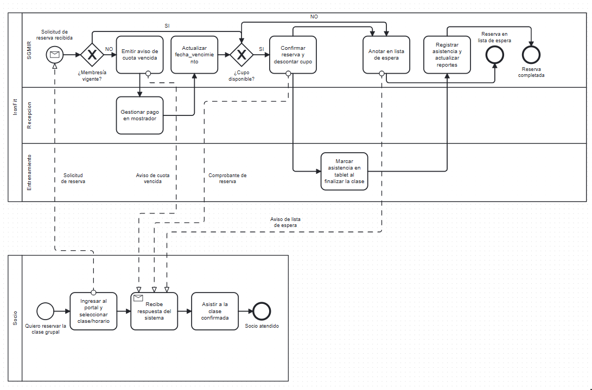

# Proceso BPMN: Reserva de clases grupales con control de cupo y morosidad

Proceso elegido porque es el corazón del SGIMR (Entrega 1): hoy se resuelve por
WhatsApp y genera sobrecupo y reservas de socios morosos. El diagrama (PNG en este
mismo directorio) usa notación BPMN estándar con dos pools y compuertas XOR para las
excepciones.

## Pools y lanes
- Pool SOCIO (actor externo), lane única: Socio.
- Pool IRONFIT (organización), lanes: Recepción, Entrenamiento, SGIMR (sistema).

## Elementos
| ID | Tipo | Lane | Nombre |
|---|---|---|---|
| e1 | Evento inicio | Socio | Quiere reservar clase grupal |
| t1 | Tarea | Socio | Ingresar al portal y seleccionar clase/horario |
| r1 | Tarea de recepción | Socio | Recibe respuesta del sistema |
| t2 | Tarea | Socio | Asistir a la clase confirmada |
| e2 | Evento fin | Socio | Socio atendido |
| mS | Evento inicio por mensaje | SGIMR | Solicitud de reserva recibida |
| g1 | Compuerta XOR | SGIMR | ¿Membresía vigente? |
| t4 | Tarea | SGIMR | Emitir aviso de cuota vencida |
| tR | Tarea | Recepción | Gestionar pago en mostrador |
| tR2 | Tarea | SGIMR | Actualizar fecha_vencimiento |
| g2 | Compuerta XOR | SGIMR | ¿Cupo disponible? |
| t6 | Tarea | SGIMR | Confirmar reserva y descontar cupo |
| t5 | Tarea | SGIMR | Anotar en lista de espera |
| t8 | Tarea | Entrenamiento | Marcar asistencia en tablet al finalizar la clase |
| t9 | Tarea | SGIMR | Registrar asistencia y actualizar reportes |
| e3 | Evento fin | SGIMR | Reserva en lista de espera |
| e4 | Evento fin | SGIMR | Reserva completada |

## Flujos de secuencia (flecha continua, dentro de cada pool)
- Socio: e1 → t1 → r1 → t2 → e2.
- IronFit: mS → g1. g1 --sí--> g2. g1 --no--> t4 → tR → tR2 → g2.
  g2 --sí--> t6 → t8 → t9 → e4. g2 --no--> t5 → e3.

## Flujos de mensaje (flecha punteada, entre pools)
- m1: t1 → mS ("Solicitud de reserva").
- m2: t4 → r1 ("Aviso de cuota vencida").
- m3: t6 → r1 ("Comprobante de reserva").
- m4: t5 → r1 ("Aviso de lista de espera").

## Excepciones contempladas
1. Membresía vencida: el sistema no rechaza en seco; deriva al pago en Recepción,
   actualiza el vencimiento y reingresa al control de cupo.
2. Cupo agotado: lista de espera en lugar de sobrecupo (problema de la Entrega 1).

